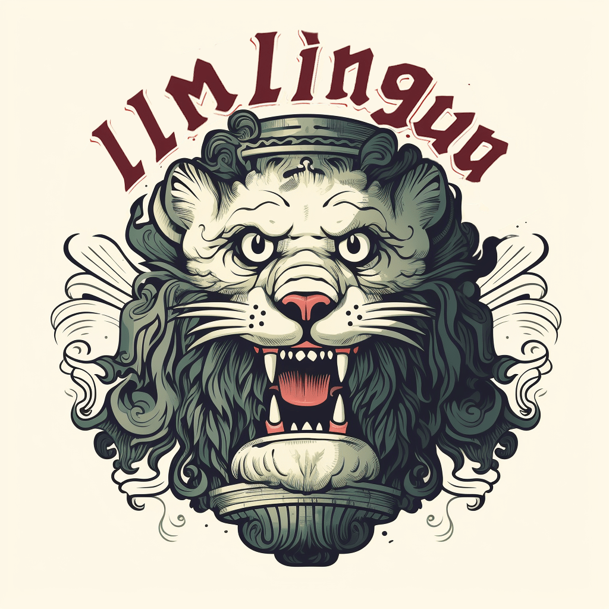
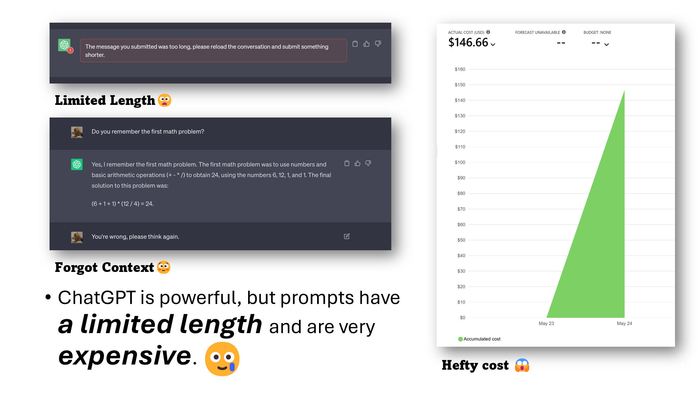
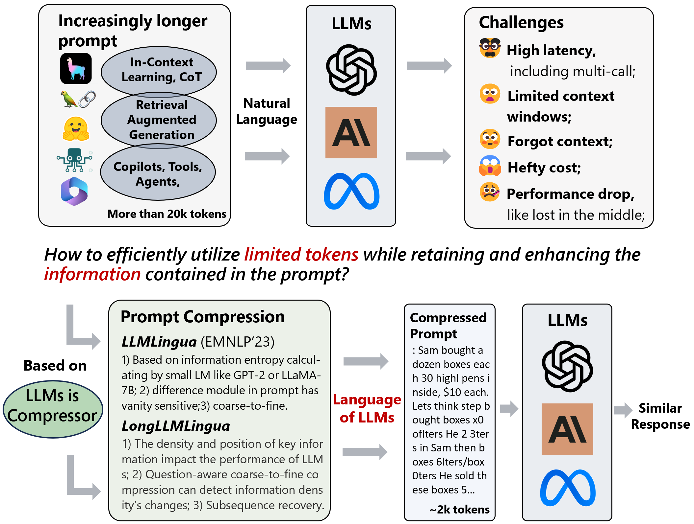
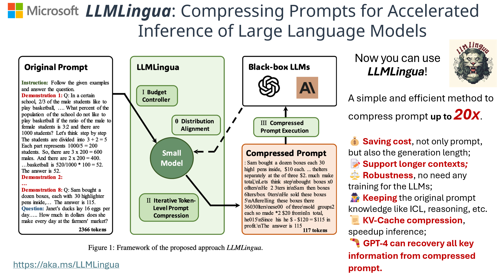
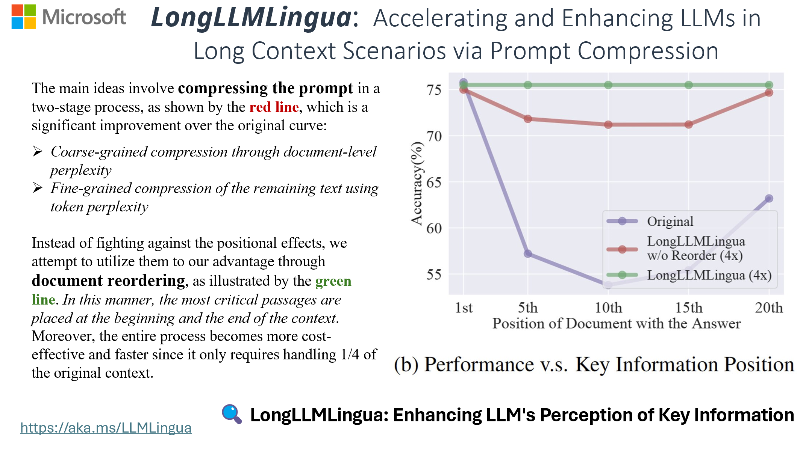
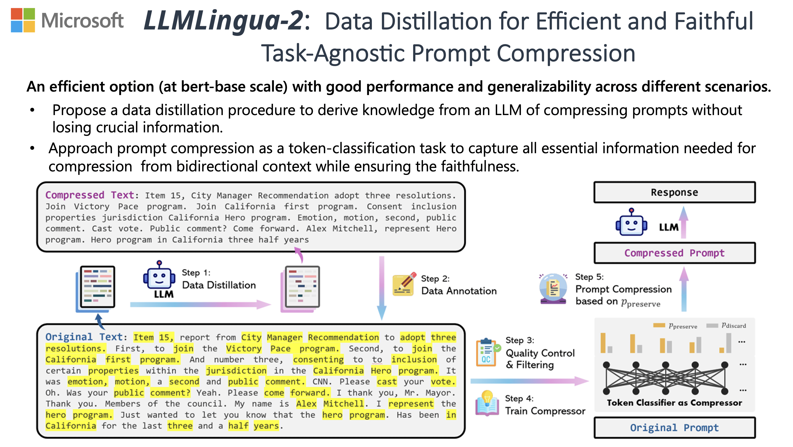

<div style="display: flex; align-items: center;">
    <div style="width: 100px; margin-right: 10px; height:auto;" align="left">
        
    </div>
    <div style="flex-grow: 1;" align="center">
        <h2 align="center">LLMLingua 系列 | 通过提示词压缩向大语言模型高效传递信息</h2>
    </div>
</div>

<p align="center">
    | <a href="https://llmlingua.com/"><b>项目主页</b></a> |
    <a href="https://aclanthology.org/2023.emnlp-main.825/"><b>LLMLingua</b></a> |
    <a href="https://aclanthology.org/2024.acl-long.91/"><b>LongLLMLingua</b></a> |
    <a href="https://aclanthology.org/2024.findings-acl.57/"><b>LLMLingua-2</b></a> |
    <a href="https://huggingface.co/spaces/microsoft/LLMLingua"><b>LLMLingua 演示</b></a> |
    <a href="https://huggingface.co/spaces/microsoft/LLMLingua-2"><b>LLMLingua-2 演示</b></a> |
</p>

<p align="center">
    <a href="README.md">English</a> · <b>简体中文</b>
</p>

https://github.com/microsoft/LLMLingua/assets/30883354/eb0ea70d-6d4c-4aa7-8977-61f94bb87438

## 最新动态
- 🍩 [24/12/13] 我们很高兴宣布发布以 KV Cache 为中心的分析工作 [SCBench](https://aka.ms/SCBench)，从 KV 缓存视角系统评估长上下文方法。
- 👘 [24/09/16] 我们很高兴宣布发布 KV Cache 卸载（offloading）工作 [RetrievalAttention](https://aka.ms/RetrievalAttention)，通过向量检索加速长上下文大语言模型推理。
- 🌀 [24/07/03] 我们很高兴宣布发布 [MInference](https://aka.ms/MInference) 以加速长上下文 LLM 推理：在单张 A100 上将预填充（pre-filling）推理延迟降低高达 **10 倍**，同时在 **100 万 Token 提示词（1M tokens prompt）**下保持原有精度！详情请参阅我们的[论文](https://arxiv.org/abs/2407.02490)并访问[项目主页](https://aka.ms/MInference)。
- 🧩 LLMLingua 已集成至 [Prompt flow](https://microsoft.github.io/promptflow/integrations/tools/llmlingua-prompt-compression-tool.html)（面向基于 LLM 的 AI 应用的高效开发工具框架）。
- 🦚 我们很高兴宣布发布 **LLMLingua-2**，相比 LLMLingua 实现了 **3 倍至 6 倍**的速度提升！详情请参阅我们的[论文](https://aclanthology.org/2024.findings-acl.57/)、访问[项目主页](https://llmlingua.com/llmlingua2.html)并体验[在线演示](https://huggingface.co/spaces/microsoft/LLMLingua-2)。
- 👾 LLMLingua 已正式集成至两大主流 RAG 框架：[LangChain](https://github.com/langchain-ai/langchain/blob/master/docs/docs/integrations/retrievers/llmlingua.ipynb) 与 [LlamaIndex](https://github.com/run-llama/llama_index/blob/main/docs/examples/node_postprocessor/LongLLMLingua.ipynb)。
- 🤳 演讲幻灯片可在 [AI Time Jan, 24](https://drive.google.com/file/d/1fzK3wOvy2boF7XzaYuq2bQ3jFeP1WMk3/view?usp=sharing) 中查看。
- 🖥 EMNLP'23 演讲幻灯片可在 [Session 5](https://drive.google.com/file/d/1GxQLAEN8bBB2yiEdQdW4UKoJzZc0es9t/view) 与 [BoF-6](https://drive.google.com/file/d/1LJBUfJrKxbpdkwo13SgPOqugk-UjLVIF/view) 中查看。
- 📚 欢迎阅读我们的最新[博客文章](https://medium.com/@iofu728/longllmlingua-bye-bye-to-middle-loss-and-save-on-your-rag-costs-via-prompt-compression-54b559b9ddf7)，探讨如何通过提示词压缩提升 RAG 效果并节约成本。代码示例请参阅[此处](https://github.com/microsoft/LLMLingua/blob/main/examples/Retrieval.ipynb)。
- 🎈 访问我们的[项目主页](https://llmlingua.com/)，查看在 RAG、在线会议（Online Meetings）、思维链（CoT）及代码生成（Code）场景下的真实案例研究。
- 👨‍🦯 探索 [`./examples`](./examples) 目录以获取丰富的实战示例，包括 [LLMLingua-2](./examples/LLMLingua2.ipynb)、[RAG](./examples/RAG.ipynb)、[在线会议](./examples/OnlineMeeting.ipynb)、[思维链 CoT](./examples/CoT.ipynb)、[代码压缩](./examples/Code.ipynb)以及[基于 LlamaIndex 的 RAG](./examples/RAGLlamaIndex.ipynb)。

## 核心摘要（TL;DR）

**LLMLingua** 利用训练良好的紧凑型语言模型（如 GPT2-small、LLaMA-7B）识别并剔除提示词（Prompt）中的非必要词元（Token）。该方法使大语言模型（LLM）能够实现高效推理，在性能损失极小的前提下实现高达 **20 倍**的压缩率。

- [LLMLingua: Compressing Prompts for Accelerated Inference of Large Language Models](https://aclanthology.org/2023.emnlp-main.825/) (EMNLP 2023)<br>
  _Huiqiang Jiang, Qianhui Wu, Chin-Yew Lin, Yuqing Yang and Lili Qiu_

**LongLLMLingua** 有效缓解了 LLM 中的“中间迷失（lost in the middle）”问题，增强了长上下文信息处理能力。它通过提示词压缩降低推理成本并提升效率，在仅使用 **1/4 Token** 的情况下将 RAG 性能提升高达 **21.4%**。

- [LongLLMLingua: Accelerating and Enhancing LLMs in Long Context Scenarios via Prompt Compression](https://aclanthology.org/2024.acl-long.91/) (ACL 2024 and ICLR ME-FoMo 2024)<br>
  _Huiqiang Jiang, Qianhui Wu, Xufang Luo, Dongsheng Li, Chin-Yew Lin, Yuqing Yang and Lili Qiu_

**LLMLingua-2** 是一种体积小巧但能力强大的提示词压缩方法，通过从 GPT-4 进行数据蒸馏（Data Distillation），使用 BERT 级别的编码器进行词元分类训练，在任务无关（task-agnostic）压缩方面表现卓越。它在处理域外（out-of-domain）数据时超越了 LLMLingua，并提供 **3 倍至 6 倍**的速度提升。

- [LLMLingua-2: Data Distillation for Efficient and Faithful Task-Agnostic Prompt Compression](https://aclanthology.org/2024.findings-acl.57/) (ACL 2024 Findings)<br>
  _Zhuoshi Pan, Qianhui Wu, Huiqiang Jiang, Menglin Xia, Xufang Luo, Jue Zhang, Qingwei Lin, Victor Ruhle, Yuqing Yang, Chin-Yew Lin, H. Vicky Zhao, Lili Qiu, Dongmei Zhang_

**SecurityLingua** 是一种安全护栏模型，利用安全感知的提示词压缩技术揭示越狱攻击（jailbreak attacks）背后的恶意意图，使 LLM 能够准确检测攻击并生成安全的回复。得益于高效的提示词压缩，该防御机制带来的额外开销微乎其微，与现有的 SOTA LLM 安全护栏方法相比，Token 成本降低了 **100 倍**。

- [SecurityLingua: Efficient Defense of LLM Jailbreak Attacks via Security-Aware Prompt Compression](https://openreview.net/forum?id=tybbSo6wba) (CoLM 2025)<br>
  _Yucheng Li, Surin Ahn, Huiqiang Jiang, Amir H. Abdi, Yuqing Yang and Lili Qiu_

## 🎥 项目概览



- 在让 ChatGPT 总结长文时，是否经常遇到 Token 长度上限？
- 在进行多轮指令微调或对话后，是否为 ChatGPT 遗忘先前的指令而感到苦恼？
- 尽管 GPT-3.5/4 API 效果出色，但高昂的调用成本是否让大规模实验难以承受？

尽管以 ChatGPT 和 GPT-4 为代表的大语言模型在泛化与推理方面表现卓越，但它们往往面临提示词长度受限以及按 Token 计费昂贵等挑战。



现在，您可以使用 **LLMLingua**、**LongLLMLingua** 和 **LLMLingua-2**！

这些工具提供了高效的提示词压缩方案，最高可实现 **20 倍压缩**，全面释放大语言模型的实用价值：

- 💰 **大幅节约成本**：以极小的额外开销同时缩短输入提示词与输出生成的长度。
- 📝 **扩展长上下文支持**：增强对更长上下文的支持能力，缓解“中间迷失（lost in the middle）”现象，并提升模型整体表现。
- ⚖️ **强鲁棒性**：无需对目标大语言模型进行任何额外训练或微调。
- 🕵️ **完备的知识保留**：完整保留原始提示词中的上下文学习（ICL）示例与推理逻辑信息。
- 📜 **KV-Cache 压缩**：显著加速模型推理过程。
- 🪃 **信息全面可恢复**：GPT-4 能够从压缩后的提示词中恢复出全部关键信息。







附注：上述演示基于 [alt-gpt](https://github.com/feedox/alt-gpt) 项目构建，特别感谢 @Livshitz 的宝贵贡献。

如果本仓库对您的研究或项目有所帮助，欢迎引用以下论文：

```bibtex
@inproceedings{jiang-etal-2023-llmlingua,
    title = "{LLML}ingua: Compressing Prompts for Accelerated Inference of Large Language Models",
    author = "Huiqiang Jiang and Qianhui Wu and Chin-Yew Lin and Yuqing Yang and Lili Qiu",
    editor = "Bouamor, Houda  and
      Pino, Juan  and
      Bali, Kalika",
    booktitle = "Proceedings of the 2023 Conference on Empirical Methods in Natural Language Processing",
    month = dec,
    year = "2023",
    address = "Singapore",
    publisher = "Association for Computational Linguistics",
    url = "https://aclanthology.org/2023.emnlp-main.825",
    doi = "10.18653/v1/2023.emnlp-main.825",
    pages = "13358--13376",
}
```

```bibtex
@inproceedings{jiang-etal-2024-longllmlingua,
    title = "{L}ong{LLML}ingua: Accelerating and Enhancing {LLM}s in Long Context Scenarios via Prompt Compression",
    author = "Huiqiang Jiang and Qianhui Wu and and Xufang Luo and Dongsheng Li and Chin-Yew Lin and Yuqing Yang and Lili Qiu",
    editor = "Ku, Lun-Wei  and
      Martins, Andre  and
      Srikumar, Vivek",
    booktitle = "Proceedings of the 62nd Annual Meeting of the Association for Computational Linguistics (Volume 1: Long Papers)",
    month = aug,
    year = "2024",
    address = "Bangkok, Thailand",
    publisher = "Association for Computational Linguistics",
    url = "https://aclanthology.org/2024.acl-long.91",
    pages = "1658--1677",
}
```

```bibtex
@inproceedings{pan-etal-2024-llmlingua,
    title = "{LLML}ingua-2: Data Distillation for Efficient and Faithful Task-Agnostic Prompt Compression",
    author = "Zhuoshi Pan and Qianhui Wu and Huiqiang Jiang and Menglin Xia and Xufang Luo and Jue Zhang and Qingwei Lin and Victor Ruhle and Yuqing Yang and Chin-Yew Lin and H. Vicky Zhao and Lili Qiu and Dongmei Zhang",
    editor = "Ku, Lun-Wei  and
      Martins, Andre  and
      Srikumar, Vivek",
    booktitle = "Findings of the Association for Computational Linguistics ACL 2024",
    month = aug,
    year = "2024",
    address = "Bangkok, Thailand and virtual meeting",
    publisher = "Association for Computational Linguistics",
    url = "https://aclanthology.org/2024.findings-acl.57",
    pages = "963--981",
}
```

```bibtex
@inproceedings{li2025securitylingua,
  title={{S}ecurity{L}ingua: Efficient Defense of {LLM} Jailbreak Attacks via Security-Aware Prompt Compression},
  author={Yucheng Li and Surin Ahn and Huiqiang Jiang and Amir H. Abdi and Yuqing Yang and Lili Qiu},
  booktitle={Second Conference on Language Modeling},
  year={2025},
  url={https://openreview.net/forum?id=tybbSo6wba}
}
```

## 🎯 快速上手

#### 1. **安装 LLMLingua：**

只需使用 `pip` 即可快速安装 LLMLingua：

```bash
pip install llmlingua
```

#### 2. **使用 LLMLingua 系列方法进行提示词压缩：**

借助 **LLMLingua**，您可以轻松压缩提示词，基本用法如下：

```python
from llmlingua import PromptCompressor

llm_lingua = PromptCompressor()
compressed_prompt = llm_lingua.compress_prompt(prompt, instruction="", question="", target_token=200)

# > {'compressed_prompt': 'Question: Sam bought a dozen boxes, each with 30 highlighter pens inside, for $10 each box. He reanged five of boxes into packages of sixlters each and sold them $3 per. He sold the rest theters separately at the of three pens $2. How much did make in total, dollars?\nLets think step step\nSam bought 1 boxes x00 oflters.\nHe bought 12 * 300ters in total\nSam then took 5 boxes 6ters0ters.\nHe sold these boxes for 5 *5\nAfterelling these  boxes there were 3030 highlighters remaining.\nThese form 330 / 3 = 110 groups of three pens.\nHe sold each of these groups for $2 each, so made 110 * 2 = $220 from them.\nIn total, then, he earned $220 + $15 = $235.\nSince his original cost was $120, he earned $235 - $120 = $115 in profit.\nThe answer is 115',
#  'origin_tokens': 2365,
#  'compressed_tokens': 211,
#  'ratio': '11.2x',
#  'saving': ', Saving $0.1 in GPT-4.'}

## 或者使用 phi-2 模型：
llm_lingua = PromptCompressor("microsoft/phi-2")

## 或者使用量化模型（如 TheBloke/Llama-2-7b-Chat-GPTQ），仅需不到 8GB 显存。
## 在此之前，请先执行：pip install optimum auto-gptq
llm_lingua = PromptCompressor("TheBloke/Llama-2-7b-Chat-GPTQ", model_config={"revision": "main"})
```

如需在您的场景中使用 **LongLLMLingua**，可调用如下代码：

```python
from llmlingua import PromptCompressor

llm_lingua = PromptCompressor()
compressed_prompt = llm_lingua.compress_prompt(
    prompt_list,
    question=question,
    rate=0.55,
    # 设置 LongLLMLingua 专属参数
    condition_in_question="after_condition",
    reorder_context="sort",
    dynamic_context_compression_ratio=0.3, # 或 0.4
    condition_compare=True,
    context_budget="+100",
    rank_method="longllmlingua",
)
```

如需在您的场景中使用 **LLMLingua-2**，可调用如下代码：

```python
from llmlingua import PromptCompressor

llm_lingua = PromptCompressor(
    model_name="microsoft/llmlingua-2-xlm-roberta-large-meetingbank",
    use_llmlingua2=True, # 是否启用 llmlingua-2
)
compressed_prompt = llm_lingua.compress_prompt(prompt, rate=0.33, force_tokens = ['\n', '?'])

## 或者使用轻量级 LLMLingua-2-small 模型
llm_lingua = PromptCompressor(
    model_name="microsoft/llmlingua-2-bert-base-multilingual-cased-meetingbank",
    use_llmlingua2=True, # 是否启用 llmlingua-2
)
```

如需在您的场景中使用 **SecurityLingua**，可调用如下代码：

```python
from llmlingua import PromptCompressor

securitylingua = PromptCompressor(
    model_name="SecurityLingua/securitylingua-xlm-s2s",
    use_slingua=True
)
intention = securitylingua.compress_prompt(malicious_prompt)
```

关于 SecurityLingua 的更多详情，请参阅 [SecurityLingua 说明文档](./experiments/securitylingua/readme.md)。

#### 3. **高级用法 - 结构化提示词压缩（Structured Prompt Compression）：**

将文本划分为多个片段，并分别指定每个片段是否需要压缩及其各自的压缩率。您可以使用 `<llmlingua></llmlingua>` 标签对上下文进行分段，并通过可选的 `rate` 和 `compress` 属性进行细粒度控制：

```python
structured_prompt = """<llmlingua, compress=False>Speaker 4:</llmlingua><llmlingua, rate=0.4> Thank you. And can we do the functions for content? Items I believe are 11, three, 14, 16 and 28, I believe.</llmlingua><llmlingua, compress=False>
Speaker 0:</llmlingua><llmlingua, rate=0.4> Item 11 is a communication from Council on Price recommendation to increase appropriation in the general fund group in the City Manager Department by $200 to provide a contribution to the Friends of the Long Beach Public Library. Item 12 is communication from Councilman Super Now. Recommendation to increase appropriation in the special advertising and promotion fund group and the city manager's department by $10,000 to provide support for the end of summer celebration. Item 13 is a communication from Councilman Austin. Recommendation to increase appropriation in the general fund group in the city manager department by $500 to provide a donation to the Jazz Angels . Item 14 is a communication from Councilman Austin. Recommendation to increase appropriation in the general fund group in the City Manager department by $300 to provide a donation to the Little Lion Foundation. Item 16 is a communication from Councilman Allen recommendation to increase appropriation in the general fund group in the city manager department by $1,020 to provide contribution to Casa Korero, Sew Feria Business Association, Friends of Long Beach Public Library and Dave Van Patten. Item 28 is a communication. Communication from Vice Mayor Richardson and Council Member Muranga. Recommendation to increase appropriation in the general fund group in the City Manager Department by $1,000 to provide a donation to Ron Palmer Summit. Basketball and Academic Camp.</llmlingua><llmlingua, compress=False>
Speaker 4:</llmlingua><llmlingua, rate=0.6> We have a promotion and a second time as councilman served Councilman Ringa and customers and they have any comments.</llmlingua>"""
compressed_prompt = llm_lingua.structured_compress_prompt(structured_prompt, instruction="", question="", rate=0.5)
print(compressed_prompt['compressed_prompt'])

# > Speaker 4:. And can we do the functions for content? Items I believe are11,,116 28,.
# Speaker 0: a from Council on Price to increase the fund group the Manager0 provide a the the1 is Councilman Super Now. the special group the provide the summerman a the Jazzels a communication from Councilman Austin. Recommendation to increase appropriation in the general fund group in the City Manager department by $300 to provide a donation to the Little Lion Foundation. Item 16 is a communication from Councilman Allen recommendation to increase appropriation in the general fund group in the city manager department by $1,020 to provide contribution to Casa Korero, Sew Feria Business Association, Friends of Long Beach Public Library and Dave Van Patten. Item 28 is a communication. Communication from Vice Mayor Richardson and Council Member Muranga. Recommendation to increase appropriation in the general fund group in the City Manager Department by $1,000 to provide a donation to Ron Palmer Summit. Basketball and Academic Camp.
# Speaker 4: We have a promotion and a second time as councilman served Councilman Ringa and customers and they have any comments.
```

#### 4. **了解更多：**

如需了解如何在 RAG、在线会议、思维链（CoT）和代码等真实场景中应用 LLMLingua 与 LongLLMLingua，请参阅我们的[**示例目录（examples）**](./examples)。如需获取详细的参数配置与使用建议，请查阅[**完整文档（DOCUMENT.md）**](./DOCUMENT.md)。

#### 5. **LLMLingua-2 的数据收集与模型训练：**

如需在您自己的自定义数据集上训练压缩器模型，请参阅我们的[**数据收集（data_collection）**](./experiments/llmlingua2/data_collection)与[**模型训练（model_training）**](./experiments/llmlingua2/model_training)指南。

## 常见问题解答（FAQ）

如需了解更多技术细节与常见疑问解答，请访问我们的 [FAQ 文档](./Transparency_FAQ.md)。

## 参与贡献（Contributing）

本项目欢迎任何形式的贡献与建议。大多数贡献需要您签署一份贡献者许可协议（CLA），声明您有权并确实授予我们使用您贡献内容的权利。详情请访问 https://cla.opensource.microsoft.com。

当您提交拉取请求（Pull Request）时，CLA 机器人会自动判断您是否需要签署 CLA，并在 PR 中给出相应提示（如状态检查、评论说明）。请直接按照机器人提供的指引操作即可。在所有使用 Microsoft CLA 的代码仓库中，您只需签署一次。

本项目已采用 [Microsoft 开源行为准则（Microsoft Open Source Code of Conduct）](https://opensource.microsoft.com/codeofconduct/)。
如需了解更多信息，请参阅[行为准则常见问题解答](https://opensource.microsoft.com/codeofconduct/faq/)，或通过 [opencode@microsoft.com](mailto:opencode@microsoft.com) 联系我们提出任何问题或意见。

## 商标声明（Trademarks）

本项目可能包含项目、产品或服务的商标或标识（Logo）。对 Microsoft 商标或标识的授权使用必须遵循 [Microsoft 商标与品牌指南](https://www.microsoft.com/en-us/legal/intellectualproperty/trademarks/usage/general)。
在本项目的修改版本中使用 Microsoft 商标或标识不得造成混淆或暗示获得了 Microsoft 的赞助。
任何对第三方商标或标识的使用均须遵守对应第三方的政策规定。

---

> **翻译说明（Translation Disclaimer）**
> 本文档由社区志愿者（[@JasonYeYuhe](https://github.com/JasonYeYuhe)）人工翻译并维护，旨在降低中文开发者的阅读门槛。最后同步日期：2026年10月17日。若译文与英文原版存在任何出入或滞后，请以 [英文原版 (README.md)](README.md) 为准。欢迎通过 PR 协助改进译文！
